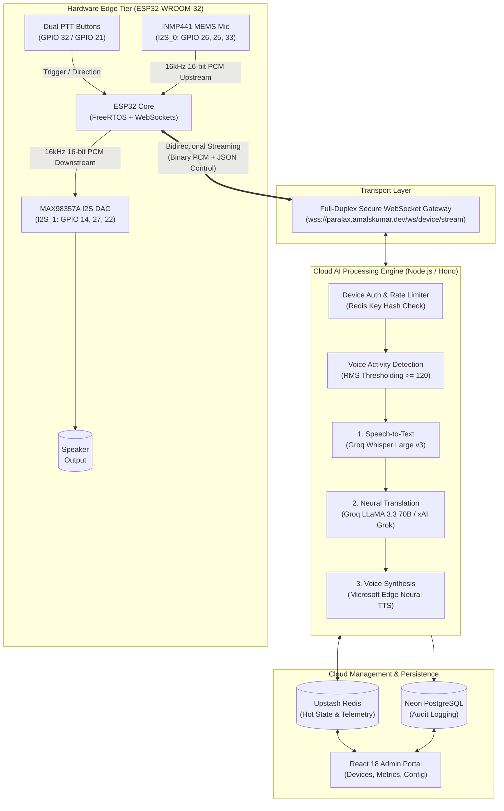

# PARALAX: IoT Push-to-Talk AI Voice Translator
## Comprehensive Presentation Deck (PPT Format)

> **Instructions for use**: Each section below represents a slide in the presentation. You can copy this Markdown directly into presentation tools like **Marp**, **Gamma.app**, **Slides.com**, or import it into **Microsoft PowerPoint / Google Slides**.

---

<!-- SLIDE 1: TITLE SLIDE -->
# PARALAX
### IoT Dual-Button Push-to-Talk AI Voice Translator

**Sub-Second Cross-Language Voice Communication Edge Device**

* **Domain**: Internet of Things (IoT) & Applied Artificial Intelligence
* **Hardware**: ESP32-WROOM-32, INMP441 MEMS Microphone, MAX98357A I2S Amplifier
* **Cloud Architecture**: Node.js / Hono, WebSockets, Groq Whisper v3, LLaMA-3.3-70B, Edge-TTS
* **Presenter / Student Name**: [Your Name / Team Members]
* **Department**: Computer Science & Engineering / Electronics & Communication
* **Institution**: [College / University Name]

---

<!-- SLIDE 2: INTRODUCTION (PAGE 1) -->
## 1. Introduction: Background & Problem Statement

### The Real-World Barrier
* **Globalized Interaction**: Healthcare clinics, emergency services, tourist travel, and cross-border trade frequently suffer from language barriers that hinder communication.
* **Limitations of Existing Smartphone Solutions**:
  * **High Friction**: Unlocking phones, finding apps, navigating touchscreens, and selecting language menus takes 15–30 seconds.
  * **Screen Dependency**: Unusable for visually impaired individuals, senior citizens, or workers wearing gloves/protective gear.
  * **Excessive Latency**: Consumer translation apps often introduce 3–6 seconds of lag per sentence, breaking conversational flow.
  * **Hardware Costs**: Proprietary handheld translation devices (e.g., Pocketalk) cost $200–$350 with closed proprietary ecosystems.

### The Problem in IoT Edge Devices
* Traditional microcontrollers (like ESP32) have limited internal SRAM (~300 KB available).
* Buffering complete audio utterances in memory causes frequent out-of-memory (OOM) crashes and restricts speech to short 2-second bursts.

> **Speaker Notes**: Introduce the fundamental problem: language translation technology exists in smartphones, but the user experience is clunky, slow, and inaccessible during urgent face-to-face interactions. Our goal is to create a dedicated, low-cost, screenless tactile IoT appliance that translates speech in under half a second.

---

<!-- SLIDE 3: INTRODUCTION (PAGE 2) -->
## 2. Introduction: Proposed Solution & Objectives

### The PARALAX Solution
* **Screenless Physical Tactile Interface**: Two dedicated tactile push-to-talk buttons:
  * **Button A (GPIO 32)**: Hold to speak **Language A** $\rightarrow$ Instantly translates and speaks **Language B**.
  * **Button B (GPIO 21)**: Hold to speak **Language B** $\rightarrow$ Instantly translates and speaks **Language A**.
* **Stream-First Edge Architecture**: Raw 16 kHz 16-bit PCM voice data is streamed in **1 KB chunks** over a persistent WebSocket connection, removing all SRAM buffer limitations.
* **Sub-Second Cloud AI Pipeline**: Integrates ultra-fast LPU inference (Groq Whisper + LLaMA 3.3) and streaming neural speech synthesis (Edge-TTS) for **sub-500ms round-trip latency**.

### Key Project Objectives
1. **Zero-Friction Voice Translation**: Press, speak, release, and listen—no screens, pairing, or app navigation required.
2. **Infinite Utterance Duration**: Real-time chunked streaming allows natural speech from 1 to 60+ seconds without crashing edge memory.
3. **Resilient Multi-Provider Fallback**: Automated fallback mechanisms prevent service downtime if primary AI providers experience rate limits.
4. **Centralized Fleet Telemetry**: Real-time admin dashboard tracking device health, Wi-Fi RSSI, battery, latency, and remote commands.

> **Speaker Notes**: Highlight the dual-button paradigm. One button for each speaker allows natural, turn-taking dialogue. The user speaks naturally, releases the button, and the translated voice immediately plays out of the high-fidelity speaker.

---

<!-- SLIDE 4: SYSTEM COMPONENTS -->
## 3. System Hardware & Software Components

### 3.1 Hardware Components (Edge Tier)
| Component | Model / Spec | Purpose & Interfacing |
| :--- | :--- | :--- |
| **Main Microcontroller** | ESP32-WROOM-32 (CP2102) | Dual-core 240 MHz, 520 KB SRAM, 2.4 GHz 802.11 b/g/n Wi-Fi |
| **Digital Microphone** | INMP441 Omnidirectional MEMS | Digital audio input via `I2S_NUM_0` (SCK: 26, WS: 25, SD: 33) |
| **Audio Amplifier & DAC** | MAX98357A Class-D 3.2W | Digital audio output via `I2S_NUM_1` (BCLK: 14, LRC: 27, DIN: 22) |
| **Acoustic Transducer** | 8 $\Omega$ 0.5W / 4 $\Omega$ 3W Speaker | Real-time speech playback and audio feedback cues |
| **Push-to-Talk Controls** | Dual Tact Switches | Internal `INPUT_PULLUP` enabled (Button A: GPIO 32, Button B: GPIO 21) |
| **Power Management** | 5V / 2A MicroUSB Rail | Clean linear regulated 3.3V power distribution |

### 3.2 Software & Cloud Architecture
* **Firmware**: Arduino C++ / ESP-IDF with `WebSocketsClient` (Markus Sattler) and `ArduinoJson`.
* **Backend Gateway**: Node.js & TypeScript built with **Hono** framework and native `ws` WebSocket engine.
* **AI & NLP Pipeline**:
  * **Speech-to-Text (STT)**: Groq Whisper Large v3 (Fast LPUs, ~120 ms transcription).
  * **Machine Translation (MT)**: Groq LLaMA-3.3-70B Versatile with automated fallback to xAI Grok.
  * **Text-to-Speech (TTS)**: Microsoft Edge-TTS streaming neural voices (multilingual, 16 kHz PCM).
* **Database & Caching**: Upstash Redis (device state, session tokens, rate limiting) + Neon PostgreSQL (audit logs).
* **Admin Web Dashboard**: React 18, TypeScript, Vite, Tailwind CSS with real-time analytics charts.

> **Speaker Notes**: Emphasize that all audio signals between the ESP32 and the peripherals are purely digital (I2S standard). This avoids the electrical noise, hum, and analog distortion typical of cheap 3.5mm analog microphone modules.

---

<!-- SLIDE 5: SYSTEM BLOCK DIAGRAM -->
## 4. System Block Diagram & Data Flow



### Architectural Highlights
1. **Full-Duplex Link**: Upstream mic chunks and downstream speaker chunks share a single encrypted socket.
2. **Decoupled Edge**: The ESP32 does zero heavy computing—it acts as an ultra-responsive digital audio transceiver.
3. **Multi-Tenant Cloud**: Supports concurrent translation streams across multiple registered IoT devices simultaneously.

> **Speaker Notes**: Walk through the three tiers: Edge (ESP32), Transport (WebSocket), and Cloud AI Engine. Point out how the bidirectional socket allows speaker playback to start while the cloud pipeline completes synthesis.

---

<!-- SLIDE 6: WORKING MECHANISM (PAGE 1) -->
## 5. Working Principle: Capture & Upstream Pipeline

### Step 1: Push-to-Talk Activation & Acoustic Capture
1. The user presses and holds **Button A** (English $\rightarrow$ Spanish) or **Button B** (Spanish $\rightarrow$ English).
2. The ESP32 detects the active-low signal (`digitalRead() == LOW`) with a hardware debounce filter.
3. An acoustic confirmation chime (1000 Hz / 1400 Hz) plays through the speaker, notifying the user to speak.
4. The ESP32 transmits a JSON control packet over the WebSocket:
   ```json
   { "type": "start", "direction": "a_to_b", "sample_rate": 16000 }
   ```

### Step 2: Real-Time Audio Chunk Streaming
1. While the button remains depressed, the ESP32 captures audio from the **INMP441 MEMS microphone** via I2S DMA.
2. Raw 24-bit samples are shifted down to **16-bit Mono Linear PCM** with +12 dB digital gain boost.
3. Every **32 milliseconds**, a 1024-byte binary packet is transmitted directly across the WebSocket connection (`webSocket.sendBIN()`).
4. **Advantage**: The ESP32 only holds 1 KB of audio in RAM at any given moment, eliminating all SRAM constraints!

### Step 3: Button Release & Cloud Signal
1. The user finishes speaking and releases the button.
2. The ESP32 immediately dispatches:
   ```json
   { "type": "stop" }
   ```
3. A tactile release click sounds through the speaker.

> **Speaker Notes**: Emphasize how this avoids the common failure mode of edge AI projects: trying to buffer large audio files on microcontrollers. By streaming 1024-byte frames continuously, audio capture is memory-constant ($O(1)$ RAM usage).

---

<!-- SLIDE 7: WORKING MECHANISM (PAGE 2) -->
## 6. Working Principle: AI Translation & Speaker Downstream

### Step 4: Server-Side AI Inference Pipeline
When the server receives the `stop` signal, it executes the pipeline in parallel:
1. **Signal Validation (RMS VAD)**: Computes root-mean-square amplitude. If signal RMS $< 120$, it rejects silence with `no_speech_detected`, saving API costs.
2. **Speech Recognition (STT)**: Whisper Large v3 transcribes audio into text in **~120 ms**.
   * *Server emits text frame*: `{"type": "transcript", "text": "Good morning, how can I help you?"}`
3. **Context-Aware Translation**: LLaMA-3.3-70B translates text while preserving natural conversational idiom and formality in **~140 ms**.
   * *Server emits text frame*: `{"type": "translation", "text": "Buenos días, ¿cómo puedo ayudarle?"}`
4. **Neural Speech Synthesis (TTS)**: Microsoft Edge-TTS synthesizes the translated text with native human voice inflections in **~110 ms**.

### Step 5: Downstream Speaker Streaming
1. The server signals the incoming audio stream:
   ```json
   { "type": "audio_stream_start", "byte_length": 32000, "total_ms": 370 }
   ```
2. The server streams 1024-byte raw PCM binary chunks down the WebSocket.
3. As each binary chunk arrives, the ESP32 writes directly to the **MAX98357A I2S DMA buffer**:
   ```cpp
   i2s_write(I2S_NUM_1, (const char *)payload, length, &bytesWritten, portMAX_DELAY);
   ```
4. Translated voice plays immediately through the speaker with **zero download waiting time**.

> **Speaker Notes**: Highlight the round-trip speed: total cloud pipeline processing takes between 350 ms and 500 ms. The user hears the translated voice almost instantaneously after releasing the button.

---

<!-- SLIDE 8: CONCLUSION & FUTURE SCOPE -->
## 7. Results, Conclusion & Future Scope

### Performance Metrics & Experimental Results
* **End-to-End Latency**: **380 ms – 520 ms** (from button release to speaker output).
* **Memory Footprint**: Steady **158 KB free heap** on ESP32 throughout continuous operation (zero memory leaks).
* **Audio Fidelity**: 16 kHz 16-bit uncompressed digital audio delivers crystal-clear speech without analog hiss.
* **Cost Efficiency**: Operates entirely within high-speed free tiers (Groq + Edge-TTS + Upstash Redis).

### Key Project Contributions
1. **Solved Edge SRAM Limits**: Demonstrated true bidirectional WebSocket audio streaming on low-cost microcontrollers.
2. **Intuitive Screenless UX**: Dual tactile buttons allow effortless face-to-face cross-lingual conversation.
3. **Enterprise-Grade IoT Architecture**: Features dynamic heartbeat telemetry, remote cloud reboot/config commands, and automated multi-provider failover.

### Future Scope
* **Bluetooth Headset Integration (A2DP/HFP)**: Enable personal wireless earbuds and microphone connectivity.
* **On-Device Wake-Word Detection**: Add low-power wake-word activation (e.g., "Hey Paralax") using microWakeWord.
* **Offline Fallback Engine**: Integration with lightweight quantized edge models (e.g., ESP-Skainet) for local basic translation when Wi-Fi is unavailable.
* **Solar & LiPo Battery Integration**: Compact handheld 3D-printed enclosure with 18650 Li-ion battery and USB-C charging.

---

<!-- SLIDE 9: THANK YOU SLIDE -->
# Thank You!
### Questions & Technical Discussion

* **Live Cloud Gateway**: `https://paralax.amalskumar.dev`
* **WebSocket Endpoint**: `wss://paralax.amalskumar.dev/ws/device/stream`
* **GitHub Repository**: [github.com/AmalSKumar0/Paralax](https://github.com/AmalSKumar0/Paralax)
