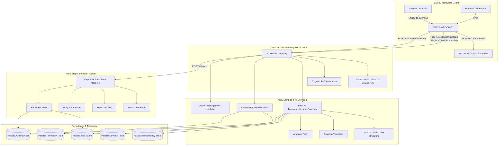

# Paralax - Serverless IoT Two-Way Voice Translator Backend on AWS

A production-grade, low-latency serverless backend for two-way voice translation between an ESP32 hardware device (INMP441 microphone, MAX98357A I2S amplifier, push-to-talk button) and a React admin dashboard.

---

## 1. System Architecture



---

## 2. Key Highlights & Architectural Decisions

- **Single HTTP Round-Trip for Devices**:
  When the device requests `Accept: application/octet-stream`, the cloud returns raw 16 kHz 16-bit PCM audio bytes directly with translation metadata in `X-*` headers. The device receives playable audio without any presigned S3 download step.
- **Direct I2S Playback (Zero Codec Overhead)**:
  Polly generates raw 16 kHz 16-bit mono PCM, enabling the ESP32 to stream bytes directly to the MAX98357A I2S DAC without an MP3/AAC decoder.
- **Two-Way Auto Detection**:
  In `mode = auto`, Amazon Transcribe Streaming utilizes `IdentifyLanguage` restricted strictly to the device's language pair (`language_a`, `language_b`). Once the spoken language is identified, target translation is automatically dispatched to the other language.
- **Deterministic Resource Naming**:
  Path B Step Functions workflows and Polly outputs use deterministic keys (`paralax-{job_id}`, `jobs/{job_id}/synthesized.mp3`) so state machine retries never duplicate resources.
- **Idempotency & Resiliency**:
  Every device request includes an `Idempotency-Key` header with 24-hour DynamoDB TTL. Replaying an identical key returns the cached response or HTTP 409 `in_progress`.

---

## 3. Deployment Guide

### Prerequisites
- Python 3.12+
- AWS CLI configured with administrator credentials
- AWS SAM CLI (`sam`)
- Docker (for `sam build --use-container`)

### Build and Deploy
```bash
# 1. Clone repository
git clone <repo_url>
cd Paralax

# 2. Build SAM application with container
sam build --use-container

# 3. Deploy guided stack
sam deploy --guided \
  --stack-name paralax-backend-dev \
  --parameter-overrides Environment=dev CorsAllowOrigin='*' RetentionDays=30
```

---

## 4. Initial Setup & Operations

### 4.1 Creating the First Cognito Admin User
```bash
USER_POOL_ID=$(aws cloudformation describe-stacks --stack-name paralax-backend-dev \
  --query "Stacks[0].Outputs[?OutputKey=='UserPoolId'].OutputValue" --output text)

aws cognito-idp admin-create-user \
  --user-pool-id "$USER_POOL_ID" \
  --username "admin@yourdomain.com" \
  --user-attributes Email="admin@yourdomain.com",EmailVerified=true \
  --temporary-password "TemporaryPass123!"

aws cognito-idp admin-set-user-password \
  --user-pool-id "$USER_POOL_ID" \
  --username "admin@yourdomain.com" \
  --password "SecureAdminPassword2026!" \
  --permanent
```

### 4.2 Provisioning a New Device
Authenticate via Cognito or temporary credentials to provision a device:
```bash
API_URL=$(aws cloudformation describe-stacks --stack-name paralax-backend-dev \
  --query "Stacks[0].Outputs[?OutputKey=='HttpApiUrl'].OutputValue" --output text)

curl -X POST "$API_URL/v1/admin/devices" \
  -H "Authorization: Bearer <COGNITO_JWT_TOKEN>" \
  -H "Content-Type: application/json" \
  -d '{
    "device_id": "esp32-wroom-01",
    "config": {
      "language_a": "en-US",
      "language_b": "es-US",
      "mode": "auto",
      "heartbeat_interval_sec": 30
    }
  }'
```
*Save the returned `device_key`. It is only shown once.*

---

## 5. Device Curl Walkthrough

### 5.1 Device Heartbeat
```bash
curl -X POST "$API_URL/v1/device/heartbeat" \
  -H "X-Device-Key: <DEVICE_KEY>" \
  -H "Content-Type: application/json" \
  -d '{
    "firmware_version": "1.0.0",
    "rssi": -58,
    "free_heap": 154200,
    "uptime_sec": 3600,
    "config_version": 1
  }'
```

### 5.2 Device Single Round-Trip Translation
```bash
curl -X POST "$API_URL/v1/device/translate?source=auto&format=pcm" \
  -H "X-Device-Key: <DEVICE_KEY>" \
  -H "Idempotency-Key: $(uuidgen)" \
  -H "Content-Type: audio/L16;rate=16000" \
  -H "Accept: application/octet-stream" \
  --data-binary @sample_speech_16k_mono.pcm \
  --output translated_speech.pcm -v
```

---

## 6. End-to-End Simulation & Verification

Test the entire backend without hardware using the built-in simulator:
```bash
# Run simulator against local or deployed endpoint
python3 tools/device_sim.py \
  --api-url "$API_URL" \
  --device-key "<DEVICE_KEY>" \
  --device-id "esp32-wroom-01" \
  --action full-sim
```

Run test suite:
```bash
make test
```

---

## 7. Alternatives Considered: AWS IoT Core with MQTT & X.509

During initial architecture design, **AWS IoT Core** using MQTT over TLS with X.509 client certificates was evaluated:
- **Why Deferred**:
  - The ESP32-WROOM-32 has only ~320 KB usable SRAM and no external PSRAM.
  - Storing X.509 certificates and performing complete mTLS handshakes consumes significant flash and memory.
  - MQTT requires packet fragmentation for 128 KB audio frames and dual round trips (uploading chunks, waiting for pub/sub notifications, and receiving download chunks).
  - A single HTTPS POST request with hashed secret headers and binary octet-stream responses achieves lower latency, smaller firmware footprint, and simpler connection pooling.

---

## 8. Future Streaming Design (Phase 2 WebSocket Architecture)

> **Documented for future roadmap. Not part of this build.**

### High-Level Architecture
For real-time full-duplex simultaneous voice translation, AWS Lambda's execution lifecycle and API Gateway WebSocket payload limits cannot maintain an ongoing bidirectional stream with Amazon Transcribe.
- **Hosting**: WebSocket server deployed as a containerized service on **AWS ECS Fargate**.
- **Bidirectional Streaming**:
  - The ESP32 opens a persistent WebSocket connection (`wss://stream.yourdomain.com/v1/stream`).
  - Sends chunked audio with sequence numbers (`chunk_seq`).
  - Server maintains an active HTTP/2 bidirectional session with Amazon Transcribe Streaming.
- **Voice Activity Detection (VAD) & Interruption Handling**:
  - Server uses WebRTC VAD or Silero VAD to detect user speech boundaries.
  - If the user starts speaking while audio is being played back, the server sends an `interrupt` command, and the ESP32 flushes its I2S DAC buffer immediately.
- **Half-Duplex Speaker Muting**:
  - While the MAX98357A speaker is playing, the INMP441 microphone stream is muted locally in hardware to avoid acoustic feedback loops.
- **Database Schema**:
  - The `ParalaxJobs` table includes a reserved nullable `session_id` column to correlate streaming utterances within a live session.
