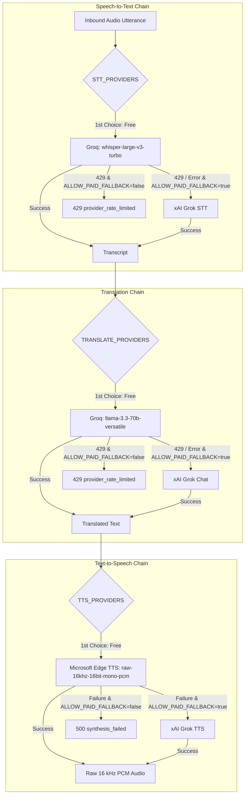

# Free-Tier Budget, Pricing & Platform Limits

This document establishes the verified service quotas, rate limits, and zero-cost constraints for the migrated Paralax IoT voice translator running as a unified Vercel project.

All primary components run on permanent free tiers with **no credit card required** and **$0.00/month recurring cost**.

---

## 1. Verified Platform Free Tiers

| Platform / Service | Free Tier Allocation | Enforced Limits | Role in Paralax |
| :--- | :--- | :--- | :--- |
| **Vercel (Hobby)** | 100 GB-hrs compute, 100 GB bandwidth / mo | 4.5 MB request/response body, maxDuration 60s, 10 concurrent functions, daily cron only | Web host & Serverless API functions |
| **Upstash Redis** | 500,000 commands / month (~16,666 / day), 256 MB data size | 10,000 commands / sec, 10 GB bandwidth / month | Hot state: devices, tokens, rate limits, commands, idempotency |
| **Neon Postgres** | 1 GB storage, 100 CU-hours / month compute | Autosuspends after 5 min idle, 5 GB network transfer / month | Cold state: jobs history, analytics, conversation logs |
| **Groq Cloud (Free Tier)** | Free API access | **STT**: 20 requests/min, 2,000 req/day; **LLM**: 30 requests/min, 1,000 req/day | Primary STT (`whisper-large-v3-turbo`) & Translation (`llama-3.3-70b-versatile`) |
| **Microsoft Edge TTS** | 100% Free, no API key or card | Native WebSocket to Azure Edge Speech endpoint | Primary TTS (`msedge-tts` streaming 16 kHz 16-bit mono PCM) |
| **Vercel Blob (Free)** | 1 GB storage, 5 GB egress / month | Optional (`store_audio=false` by default) | Audio persistence for historical audio playback |

---

## 2. Audio & AI Provider Fallback Matrix

### Fallback Protection (`ALLOW_PAID_FALLBACK`)
* `ALLOW_PAID_FALLBACK=false` (Default): Any provider requiring monetary credits (such as xAI) is strictly bypassed. The system remains 100% free under all conditions.
* When `ALLOW_PAID_FALLBACK=true`: Paid fallback providers (xAI) are only queried if free providers experience outages or HTTP 429 rate limiting.

---

## 3. Provider Cost & Quota Economics

### Groq (Free Tier)
* **Whisper (`whisper-large-v3-turbo`)**:
  * Rate limit: **20 requests / minute**
  * Daily limit: **2,000 requests / day**
  * Minimum billed duration: 10 seconds per request
  * Cost: **$0.00**
* **LLaMA 3.3 (`llama-3.3-70b-versatile`)**:
  * Rate limit: **30 requests / minute**, **1,000 requests / day**
  * TPM limit: **12,000 tokens / minute**
  * Cost: **$0.00**

### Microsoft Edge TTS (`msedge-tts`)
* Free, public neural voices (Jenny, Paloma, Denise, Henri, etc.)
* Native format: `raw-16khz-16bit-mono-pcm` (no transcoding needed)
* Cost: **$0.00**

### xAI Grok (Paid Reference Pricing - Incurred Only When Enabled)
* **STT**: $0.10 / hour of audio (~$0.00011 per 4-second utterance).
* **Translation (Grok 4.3)**: $1.25 / 1M input tokens, $2.50 / 1M output tokens (~$0.00015 per translation).
* **TTS**: $15.00 / 1,000,000 characters (~$0.00097 per 65-character utterance).
* **Total Cost per 1,000 Utterances (xAI Fallback)**: ~$1.23 per 1,000 full round trips.

---

## 4. Platform Quota Sizing & Capacity Planning

Assuming **1,000 utterances per day** across 10 active ESP32 devices:

| Metric | Daily Consumption | Free Tier Allowance | Headroom |
| :--- | :--- | :--- | :--- |
| **Vercel Functions** | 1,000 invocations @ ~1.2s = 0.33 GB-hr | 100 GB-hr / mo (~3.3 GB-hr / day) | 90% unused |
| **Upstash Redis** | ~4,000 commands (heartbeats + rate limits + jobs) | 16,666 commands / day | 76% unused |
| **Neon Postgres** | 1,000 job rows (~500 KB / day) | 1,000 MB (1 GB) storage | > 99% unused |
| **Groq Whisper** | 1,000 STT requests | 2,000 requests / day | 50% unused |
| **Groq LLaMA** | 1,000 translation requests | 1,000 requests / day | 100% capacity |
| **Edge TTS** | 1,000 audio syntheses | Unlimited free requests | 100% headroom |
| **Vercel Blob** | 0 MB (default `store_audio=false`) | 1,000 MB storage | 100% unused |

---

## 5. Architectural Guardrails & Vercel Hobby Constraints

1. **4.5 MB Payload Limit**:
   * ESP32 firmware and frontend enforce a hard **4.0 MB audio cap** client-side and server-side. Audio longer than 20 seconds is rejected immediately with HTTP 422 `audio_too_long`.
2. **Execution Timeout**:
   * All API functions configure `maxDuration: 60` seconds. With Groq Whisper (~300ms) + LLaMA (~250ms) + Edge TTS (~500ms), typical synchronous Path A latency is **1,000 - 1,500 ms**, well within the 60-second limit.
3. **No Streaming WebSockets**:
   * Vercel serverless functions do not support long-lived inbound WebSocket servers. Single-round-trip HTTPS request (`POST /v1/device/translate`) is the primary design pattern.
4. **Daily Retention Cleanup**:
   * Vercel Hobby plan permits **one cron invocation per day** (`0 0 * * *`). The `/api/cron/retention` route automatically cleans up expired database records and blobs exceeding `retention_days`.
